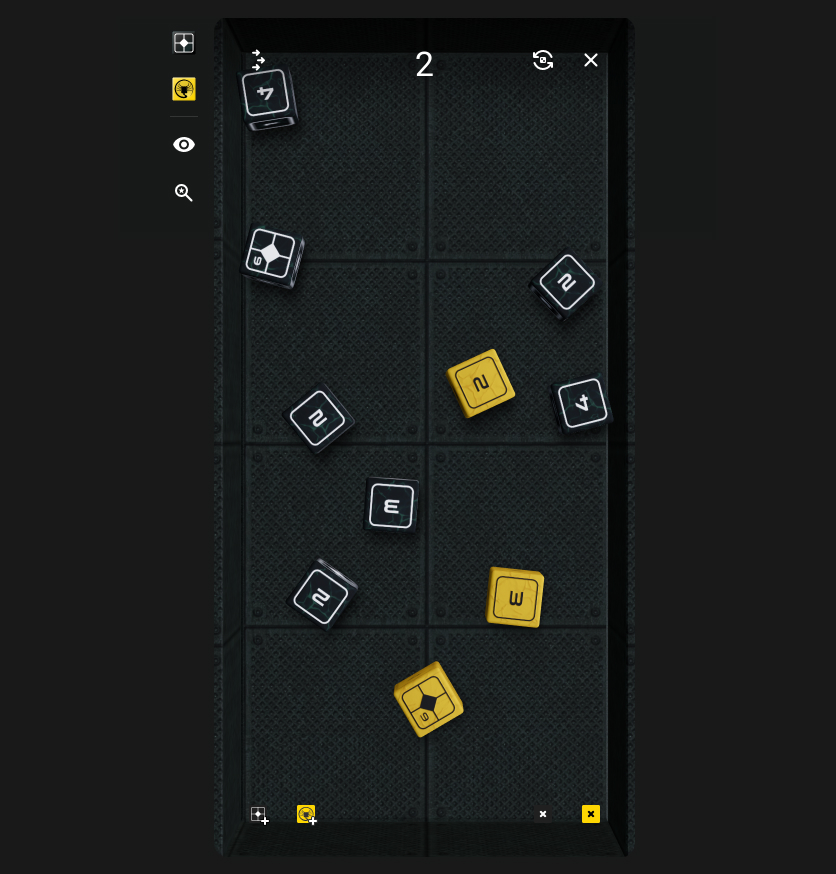

# Alien RPG Dice for Owlbear Rodeo

Beautiful unofficial Owlbear Rodeo dice extension for Free League's Alien RPG, based on the [Owlbear Rodeo Dice Extension](https://github.com/owlbear-rodeo/dice).

## Building

This project uses [Yarn](https://yarnpkg.com/) as a package manager.

To install all the dependencies run:

`yarn`

To run in a development mode run:

`yarn dev`

The dev server runs at `http://localhost:7513`. Install `http://localhost:7513/manifest.json` in Owlbear Rodeo to test locally: its name has " (local)" added, so it can be told apart from the published extension.

To make a production build run:

`yarn build`

## Project Structure

All source files can be found in the `src` folder.

## License

GNU GPLv3